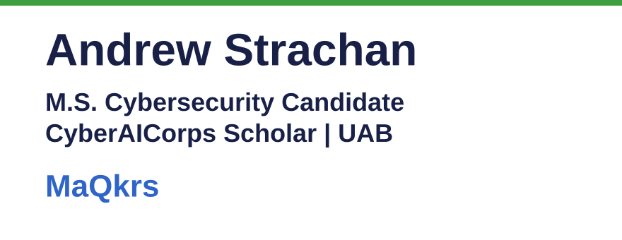

<p align="center">
  <picture>
    <source media="(prefers-color-scheme: dark)" srcset="docs/brand/banner-dark.svg">
    
  </picture>
</p>

# Andrew Strachan

**M.S. Cybersecurity Candidate | CyberAICorps Scholar | UAB**

Andrew Strachan is a full-time Master of Science, Cybersecurity student at the University of Alabama at Birmingham (UAB), January 2026 – expected December 2027. He is an SFS CyberAICorps scholarship recipient. The scholarship is NSF-funded, with a post-graduation government service commitment.

He is Founder & Technologist at MaQkrs Consulting (MS & AL), January 2022 – Present.

**Status:** Public profile. Live: https://github.com/astrachan163 · Part of [Andrew Strachan's portfolio](https://www.nonartificialsi.com).

## Featured

### MaQkrs AI Tutor

Pre-release beta. Cited answers, on your device.

- Public repository: [MaqkrsTutor-public](https://github.com/astrachan163/MaqkrsTutor-public)
- Portfolio page: https://www.nonartificialsi.com/maqkrstutor/ (noindex until launch)

### AdaptiveHS

A K-12 homeschool adaptive learning platform.

Live: https://adaptivehs-v2.web.app

### Portfolio

https://www.nonartificialsi.com

## Links

- LinkedIn: https://www.linkedin.com/in/andrew-william-strachan
- Electronic Career Portfolio: https://astrachan163.github.io/electronic-career-portfolio/
- Email: strachan@uab.edu

## Tests and checks

This repository is a profile page. It has no install step, build, linter, or unit suite. Run these from the repository root:

```sh
node scripts/check-claims.mjs
node scripts/check-emoji.mjs
gitleaks dir . --redact
```

## Security

No secrets are committed. Report a problem to strachan@uab.edu.

## Credits

Author: Andrew Strachan.
