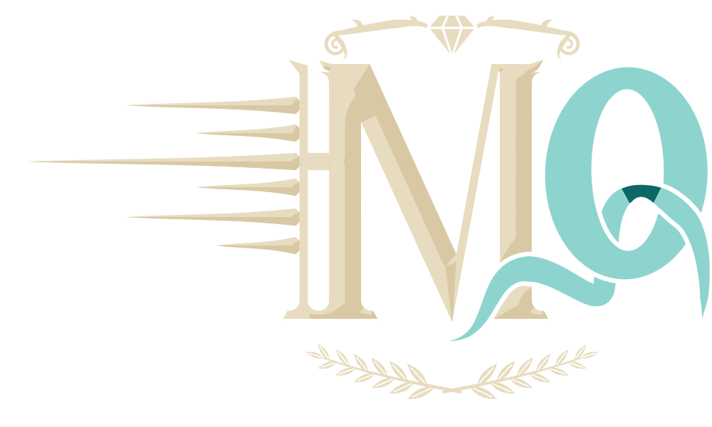
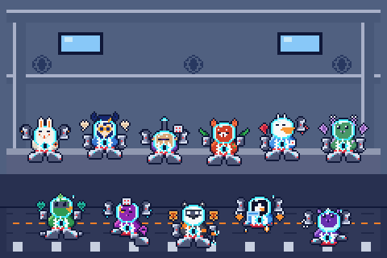

  

# MaQkrs

## Andrew Strachan

**M.S. Cybersecurity Candidate | SFS CyberAICorps Scholarship Recipient | UAB**

I'm a full-time Master of Science, Cybersecurity student at the University of Alabama at Birmingham (UAB), with expected completion in December 2027. I'm an SFS CyberAICorps scholarship recipient.

I'm Founder & Technologist at MaQkrs Consulting, based in Birmingham, Alabama, serving clients in Alabama, Mississippi, Tennessee, and Georgia.

## Featured

### MaQkrs AI Tutor

An on-device study assistant for Mac, iPhone, and iPad, currently in beta testing.

- Earlier public source snapshot: [MaqkrsTutor-public](https://github.com/astrachan163/MaqkrsTutor-public)
- [App information and support](https://www.nonartificialsi.com/maqkrstutor/)
- [TestFlight invitation](https://testflight.apple.com/join/MH2RJQTd)

### AdaptiveSchool

A schooling portal for students, teachers, and parents. The hosted demo uses sample data.

[Explore AdaptiveSchool](https://adaptiveschool.nonartificialsi.com/)

### Portfolio

[Projects and work](https://www.nonartificialsi.com/) · [Electronic Career Portfolio](https://astrachan163.github.io/electronic-career-portfolio/)

## Ecosystem

  

<table>
  <thead>
    <tr><th>Mascot</th><th>App</th><th>Link</th></tr>
  </thead>
  <tbody>
    <tr>
      <td></td>
      <td>Portfolio</td>
      <td><a href="https://www.nonartificialsi.com/">Portfolio</a></td>
    </tr>
    <tr>
      <td></td>
      <td>Victorious Herbal Elements</td>
      <td><a href="https://herbal.nonartificialsi.com/">Herbal</a></td>
    </tr>
    <tr>
      <td></td>
      <td>CS646 Sanctum</td>
      <td><a href="https://sanctum.nonartificialsi.com/">Sanctum</a></td>
    </tr>
    <tr>
      <td></td>
      <td>AdaptiveSchool</td>
      <td><a href="https://adaptiveschool.nonartificialsi.com/">AdaptiveSchool</a></td>
    </tr>
    <tr>
      <td></td>
      <td>MaQkrs Command Center</td>
      <td><a href="https://maqkrs-command-center-i.firebaseapp.com/">Command Center</a></td>
    </tr>
  </tbody>
</table>

## More projects

- [MaQkrs Learn](https://ghs-lp-dev-astrachan163.web.app/)
- [Legacy Meadows](https://legacy.nonartificialsi.com/) — demonstration only.
- [Brand kit](https://www.nonartificialsi.com/brand/)

## Links

- [LinkedIn](https://www.linkedin.com/in/andrew-william-strachan)
- [Electronic Career Portfolio](https://astrachan163.github.io/electronic-career-portfolio/)
- [Email](mailto:strachan@uab.edu)

## Credits

Author: Andrew Strachan.

  <a href="https://www.nonartificialsi.com/">Built by MaQkrs</a>

Checks for this page: [docs/CHECKS.md](docs/CHECKS.md).
